

  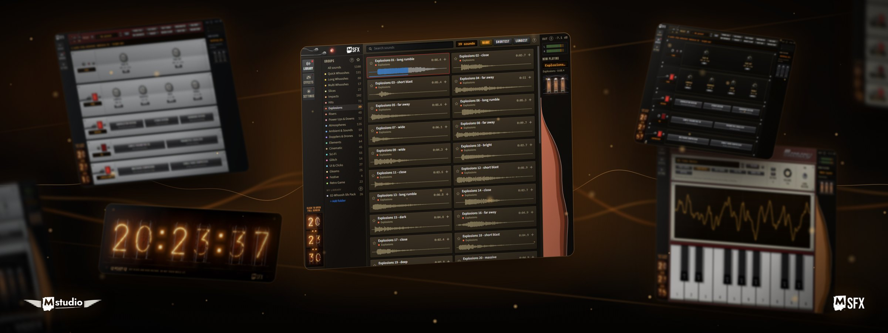

  <b>Free sound effects for Premiere Pro and After Effects, in a panel built like a tube amp.</b> 
  Find a sound, hear it on hover, drop it on your timeline.

  

  <b>On a Mac?</b> MSFX is coming to the <b>Adobe Marketplace</b> in Creative Cloud, where it installs in one click &mdash; no download needed. <a href="https://mstudio.site">Get notified at mstudio.site</a>.

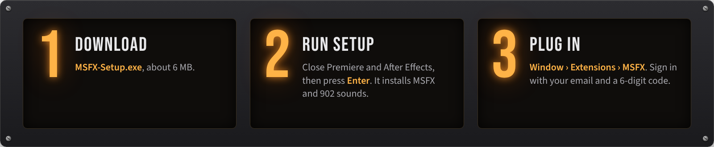

> ⚠️ **"Windows protected your PC" / unknown publisher?** Windows Defender SmartScreen shows this blue screen for any new app that few people have downloaded yet — it is **not** a virus warning. Click **More info**, then **Run anyway**. Setup only installs MSFX files that carry our own digital signature, and it refuses anything else.

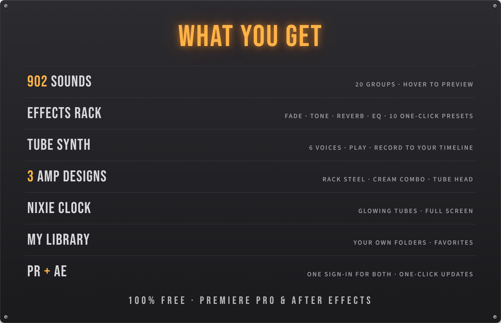

## A closer look

<table>
<tr>
<td width="55%">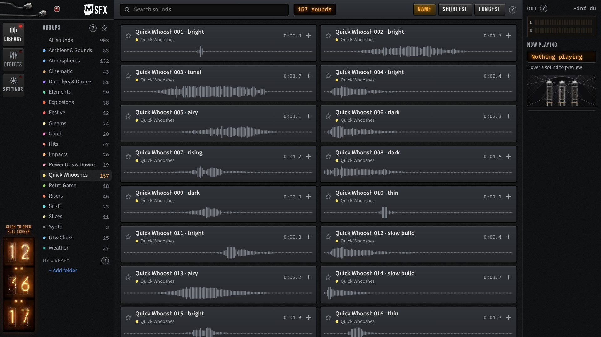</td>
<td><h3>The library</h3>902 sounds in 20 groups: Quick Whooshes, Atmospheres, Impacts, Hits, Risers, Explosions, Glitch, Sci-Fi, Retro Game, UI &amp; Clicks and more. Hover a sound to hear it, search with <code>/</code>, star your favorites, then press <b>+</b> or drag it onto your timeline.</td>
</tr>
<tr>
<td>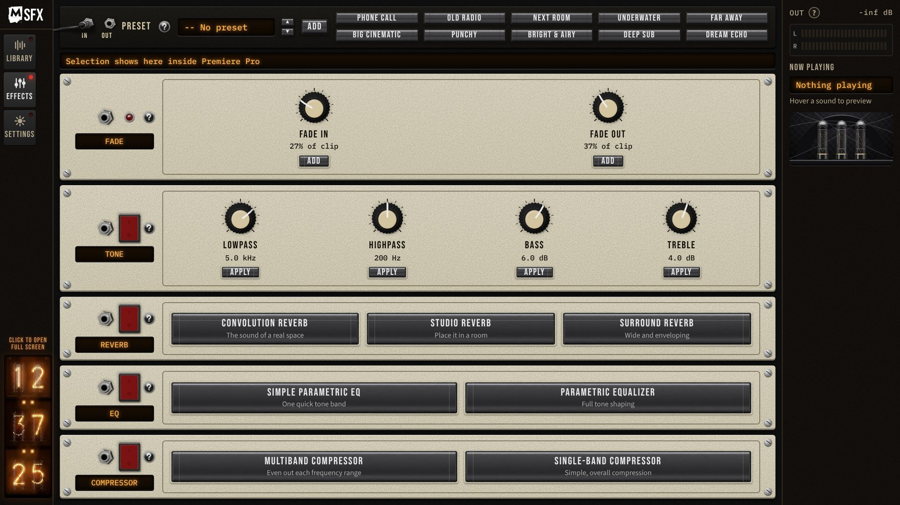</td>
<td><h3>The effects rack</h3>Select audio clips in your timeline, then add a fade, cut the lows or highs, boost bass and treble, or put the sound in a room with reverb and EQ. Or pick one of 10 presets: <i>Phone Call, Old Radio, Next Room, Underwater, Far Away, Big Cinematic, Punchy, Bright &amp; Airy, Deep Sub</i> and <i>Dream Echo</i>.</td>
</tr>
<tr>
<td>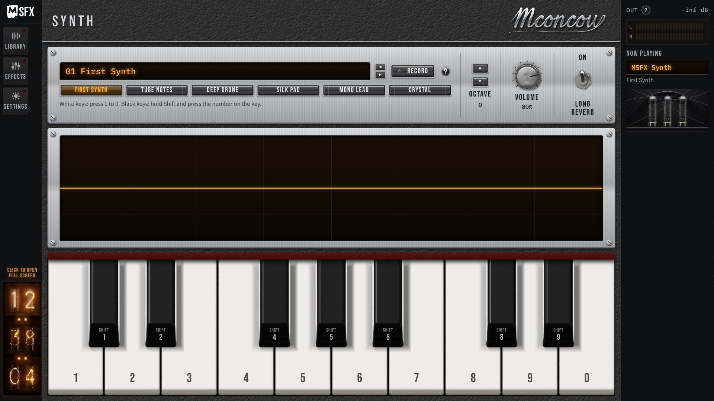</td>
<td><h3>The tube synth</h3>Click the MSFX logo and a synth opens. It has six voices you play with the number keys, octave and reverb controls, and a <b>Record</b> button that puts your take straight onto a new audio track.</td>
</tr>
<tr>
<td>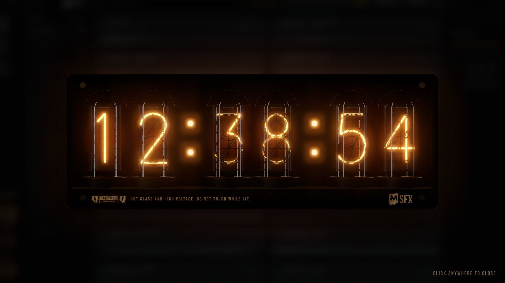</td>
<td><h3>The nixie clock</h3>A glowing tube clock sits in the corner of the panel. Click it to go full screen.</td>
</tr>
</table>

### Pick your amp

  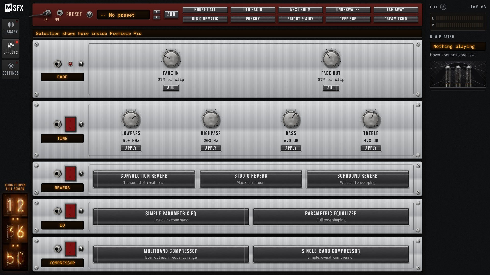
  
  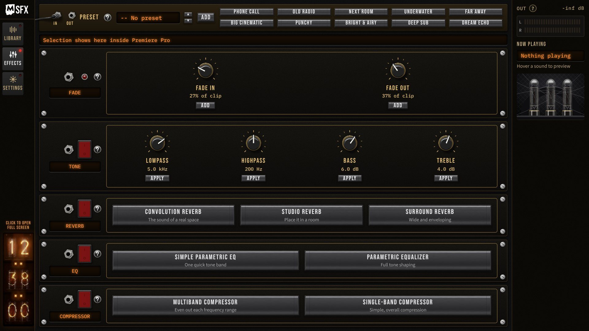

<b>Rack Steel</b> &nbsp;·&nbsp; <b>Cream Combo</b> &nbsp;·&nbsp; <b>Tube Head</b>. Switch any time in Settings.

### Sign in once, stay up to date

  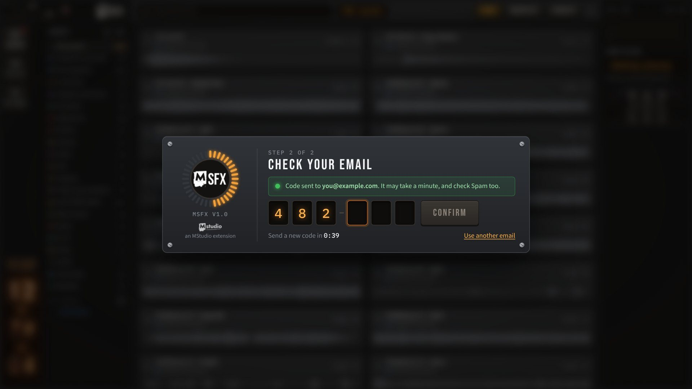
  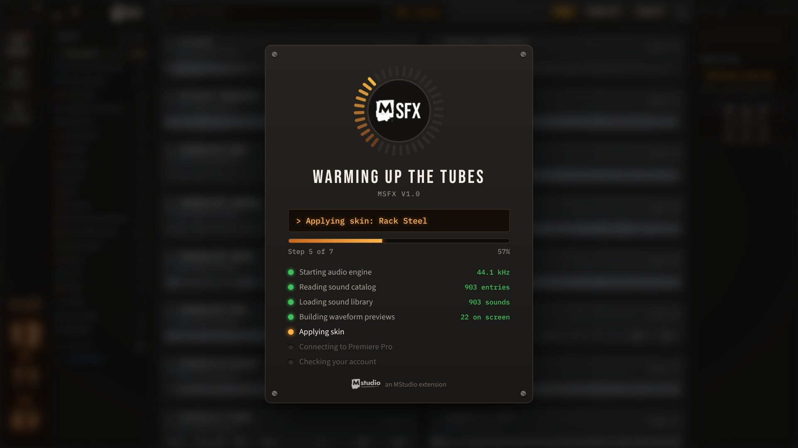

Type your email and MSFX sends you a 6-digit code. There's no password and no payment, and one sign-in covers Premiere Pro and After Effects. New versions and new sound packs then arrive inside the panel with one click.

## Requirements

| What | Needed |
|---|---|
| **System** | Windows 10 or 11 · on Mac, via the Adobe Marketplace (coming soon) |
| **Premiere Pro** | 2022 and newer, including 2026 |
| **After Effects** | 2022 and newer, including 2026 |
| **Disk space** | About 250 MB |
| **Internet** | To install, sign in, and get updates. MSFX keeps working offline for up to 7 days at a time. |

You don't need both apps. Setup installs MSFX for both, so it's ready when you open either one.

## Updating and removing

- **Updates:** MSFX tells you inside the panel when something new is ready, and installs it with one click. If an update ever goes wrong, MSFX puts the previous version back by itself.
- **Uninstall:** go to **Windows Settings › Apps › Installed apps › MSFX › Uninstall**. Sounds you've already used in projects stay in `Documents\MSFX\Used sounds`, so your projects keep working.
- **Offline install:** from the [latest release](../../releases/latest), download all three files (**MSFX-Setup.exe**, **MSFX-app.msfxrelease** and **MSFX-library.msfxrelease**) into one folder, then run MSFX-Setup.exe.

## Questions

<b>Is MSFX really free?</b>

 Yes, 100%. If you'd like to support us, there's a "Buy us a coffee" button on the back panel in Settings.

<b>Why do I need to sign in?</b>

 Signing in unlocks the sound library on your computer and keeps MSFX up to date. We only ask for your email address. One account works on up to 3 computers.

<b>My antivirus warns about MSFX-Setup.exe.</b>

 Some antivirus apps are careful with new installers that download files. Only download MSFX from this page or from <a href="https://mstudio.site">mstudio.site</a>. If you'd rather not run the downloader, use the offline install above.

<b>I don't see MSFX under Window › Extensions.</b>

 Restart Premiere Pro or After Effects after installing. If it's still missing, run MSFX-Setup.exe again. It's safe to run more than once.

<b>Can I use MSFX on a Mac?</b>

 The installer on this page is for Windows. On macOS, MSFX is coming to the <b>Adobe Marketplace</b> in the Creative Cloud app, where it installs in one click with no separate download. It's in preparation now &mdash; watch <a href="https://mstudio.site">mstudio.site</a> or email <b>support@mstudio.site</b> to hear when it's live.

Still stuck? Write to **support@mstudio.site**.

## Sound credits

The library combines sounds recorded by the MSFX team with sounds that 309 creators released under the CC0 licence on [Freesound](https://freesound.org). Thank you, every one of you. The full list is in MSFX: click the **©** on the back panel in Settings.

> ⚠️ **Caution:** some sounds are loud. Check your levels before playing.

---

  Created and mastered by <b>John Mconcow</b> · <b>MStudio</b> · <a href="https://mstudio.site">mstudio.site</a> 
  © MStudio. All rights reserved.

